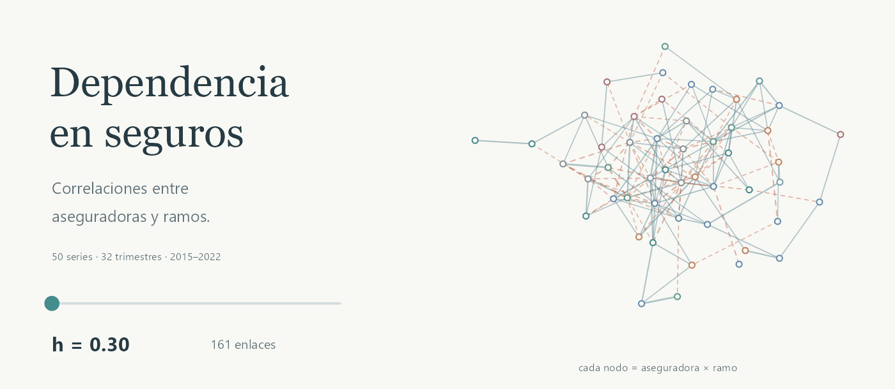
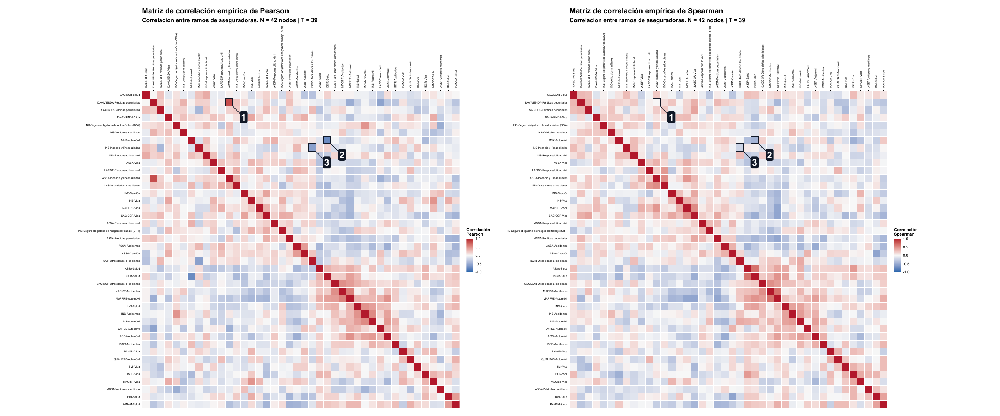
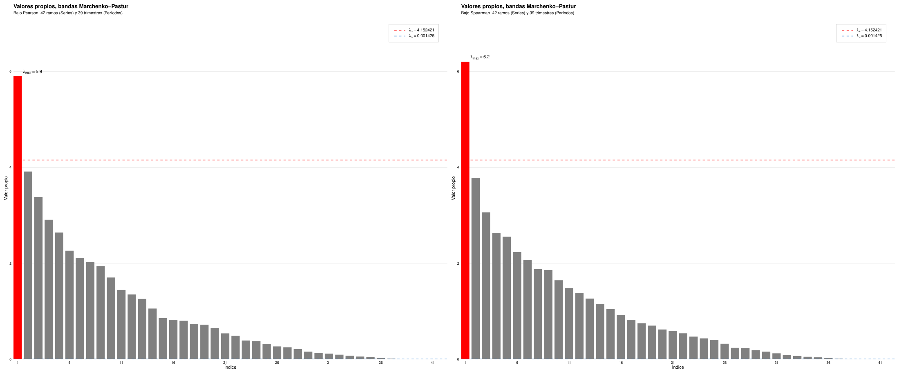
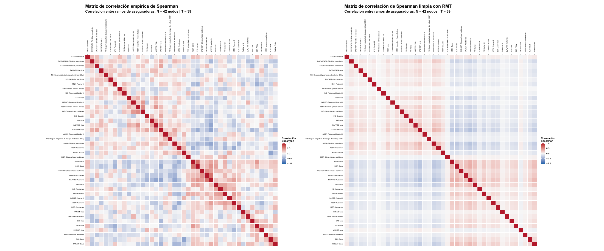

<picture>
  <source media="(prefers-reduced-motion: reduce)" srcset="docs/assets/portada.png">
  
</picture>

# Dependencia en el mercado asegurador costarricense

<p>
  
  
  
  
</p>

Proyecto de Análisis Numérico I de la Universidad de Costa Rica, II ciclo de 2026.

El proyecto estudia cómo se relacionan los ramos de distintas aseguradoras a partir de los datos públicos de primas y siniestros de SUGESE. El análisis parte de las matrices de correlación y estudia sus valores propios con herramientas de teoría de matrices aleatorias (RMT).

El panel actual contiene **42 series de 12 aseguradoras y 39 trimestres, de 2017-T1 a 2026-T3**.

## Los datos y la matriz

Los montos trimestrales se toman del reporte «Resultado Técnico-Financiero» de SUGESE. Se conservan las series con prima positiva y un *loss ratio* (LR) calculable en los 39 trimestres. [Reportes de SUGESE](https://www.sugese.fi.cr/cr/es/estadisticas.html) · [Excel del proyecto](datos/datos_originales/Reporte_Cuentas_Tecnicas.xlsx)

$$
\mathrm{LR} = \frac{\text{Siniestralidad neta de reaseguro}}{\text{Primas imputadas netas de reaseguro}}
$$

Cada fila de `L` corresponde a una combinación de aseguradora y ramo, y cada columna a un trimestre. Para Pearson se usan los valores del LR y para Spearman, sus rangos dentro de cada serie. En ambos casos se centran y estandarizan las filas para obtener `X`.

```r
C <- (X %*% t(X)) / (T_serie - 1)
```

El divisor es `T_serie - 1` porque se usa la desviación estándar muestral.

### Pearson y Spearman

Se compararon las dos matrices para elegir cuál usar en el resto del análisis. Los mapas usan la misma escala de color. Cada figura se puede abrir en PDF haciendo clic sobre ella. Las marcas señalan tres pares en los que la correlación se acerca a cero al pasar de Pearson a Spearman.

[](graficos/comparacion_pearson_spearman_marcada.pdf)

| Celda | Series | Pearson | Spearman |
| --- | --- | ---: | ---: |
| 1 | DAVIVIENDA–Pérdidas pecuniarias y ASSA–Incendio y líneas aliadas | 0,816 | 0,003 |
| 2 | MNK–Automóvil e ISCR–Salud | −0,726 | −0,435 |
| 3 | INS–Incendio y líneas aliadas e ISCR–Otros daños a los bienes | −0,574 | −0,227 |

Todas estas celdas comparten que al menos uno de los LR superó 2 en el trimestre que más influyó en Pearson. En 2017-T4, los LR del primer par fueron 5,50 y 2,44. En 2018-T4, los del segundo fueron 11,17 y −0,72. En 2017-T2, los del tercero fueron −1,65 y 3,28. Se eligió Spearman porque usa el orden de los LR dentro de cada serie. Así se conservan los 39 trimestres y se reduce la influencia de la magnitud de los valores extremos en la correlación.

## El trabajo con RMT

El espectro de cada matriz se compara con la banda de Marchenko–Pastur. Con `q = N/T = 42/39`, el borde superior de referencia es 4,1524. Solo un valor propio lo supera en cada matriz. En Pearson es 5,9002 y en Spearman, 6,2003.

[](graficos/comparacion_pearson_spearman_eigen.pdf)

### Limpieza de la matriz de Spearman

Se conserva el valor propio que supera el borde superior y se reemplazan los otros 41 por su promedio, 0,8732. La matriz se reconstruye con los mismos vectores propios y se reescala para que la diagonal vuelva a valer uno. Los dos mapas usan el mismo orden de series y la misma escala de color.

[](graficos/comparacion_spearman_rmt.pdf)

## Ejecución

Abrir el [proyecto de RStudio](riesgo_mercado_asegurador_MA0501.Rproj). Ejecutar los comandos desde la raíz del proyecto.

```r
install.packages(c("here", "ggplot2", "patchwork", "readxl", "tidyverse"))
```

<details>
<summary>Volver a procesar el Excel y ejecutar el análisis</summary>

```r
source("R/1_seleccionar_panel.R", encoding = "UTF-8")
source("R/2_crear_L.R", encoding = "UTF-8")
source("R/3_crear_X.R", encoding = "UTF-8")
source("R/4_analisis_empirica.R", encoding = "UTF-8")
source("R/5_RMT.R", encoding = "UTF-8")
source("R/6_limpiar_correlacion.R", encoding = "UTF-8")
```

Los scripts [2](R/2_crear_L.R) y [3](R/3_crear_X.R) definen las funciones que construyen `L` y estandarizan las series. Los pasos 4 y 5 los cargan automáticamente.

El paso 1 reconstruye el panel desde el Excel. Si se usa el panel que ya está en el repositorio, se puede empezar en el paso 4. El paso 6 guarda la matriz limpia en `resultados/correlacion_spearman_limpia.csv`.

</details>

## Archivos del proyecto

| Archivo o carpeta | Contenido |
| --- | --- |
| [Datos](datos/) | Excel original y panel trimestral procesado. |
| [Scripts en R](R/) | Selección del panel, correlaciones, espectros y limpieza. |
| [Gráficos](graficos/) | Mapas de correlación y comparaciones de los espectros. |
| [Avance 1](informes/Avance%201.pdf) · [Fuente de Quarto](informes/Avance%201.qmd) | Trabajo sobre la [base anterior](datos/datos_originales/Reporte_Primas_Y_Siniestros_Por_Ramo_Y_Aseguradora.xlsx), en el período 2015–2022.<br>$\mathrm{LR}_{\text{brutas}} = \frac{\text{Siniestros pagados}}{\text{Primas brutas}}$.<br>Algunas primas trimestrales muy bajas o negativas dieron LR de 49,44 y −64,12. Al usar montos brutos, las primas reportadas y los siniestros pagados podían quedar desfasados en el tiempo. Esos valores podían distorsionar algunas correlaciones, por lo que el análisis actual usa la cuenta técnica y exige prima positiva. |
