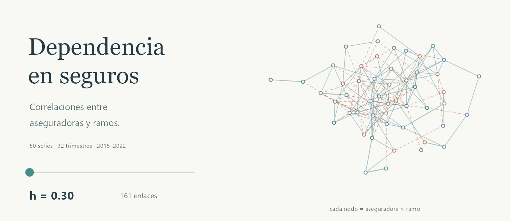

<picture>
  <source media="(prefers-reduced-motion: reduce)" srcset="docs/assets/portada.png">
  
</picture>

# Dependencia en el mercado asegurador costarricense

<p>
  
  
  
  
</p>

Proyecto de Análisis Numérico I de la Universidad de Costa Rica, II ciclo de 2026.

El proyecto estudia cómo se relacionan los ramos de distintas aseguradoras a partir de los datos públicos de primas y siniestros de SUGESE. El análisis parte de una matriz de correlación, representada como una red de conexiones entre series y estudiada a través de sus valores propios con herramientas de teoría de matrices aleatorias (RMT).

El panel actual contiene **50 series aseguradora–ramo y 32 trimestres, de 2015 a 2022**. El repositorio reúne el procesamiento de los datos, los scripts de R y las figuras del análisis.

## Los datos y la matriz

La fuente es el reporte **«Primas y siniestros — Por ramo y aseguradora»** de [SUGESE](https://www.sugese.fi.cr/cr/es/estadisticas.html). El Excel está en [`datos/datos_originales/`](datos/datos_originales/).

Los montos vienen acumulados dentro de cada año. Los flujos trimestrales se obtienen con el cierre de marzo y las diferencias entre cierres consecutivos. Después se calcula `loss_ratio = siniestros_brutos / primas_brutas` y se conservan las series completas en el período común del panel.

Cada fila de `L` es una combinación de aseguradora y ramo; cada columna es un trimestre. Cada fila se centra y estandariza para obtener `X`. La matriz empírica se calcula con:

```r
C <- (X %*% t(X)) / (T_serie - 1)
```

El divisor es `T_serie - 1` porque la estandarización usa la desviación estándar muestral.

<details>
<summary>Ver la matriz de correlación</summary>


La diagonal vale uno. Los colores muestran el signo y la magnitud de la correlación.

</details>

## Las redes

Cada nodo es una serie aseguradora–ramo. El color identifica a la aseguradora; los enlaces azules son positivos y los naranjas discontinuos son negativos. El grosor depende de `|ρᵢⱼ|`.

### Elegir un umbral

Se conserva un enlace cuando `|ρᵢⱼ| ≥ h`. Al subir `h` quedan menos conexiones. Los nodos aislados permanecen en la figura para poder comparar el mismo conjunto de series.

| `h` | Enlaces | Positivos | Negativos |
| --- | ---: | ---: | ---: |
| 0.30 | 161 | 94 | 67 |
| 0.40 | 68 | 42 | 26 |
| 0.50 | 32 | 18 | 14 |


Las tres figuras usan las mismas posiciones de los nodos. Para probar otros valores, modificar esta línea en [`R/visualizar_redes.R`](R/visualizar_redes.R):

```r
h <- c(.30, .40, .50)
```

### Conservar la planaridad: PMFG

El *Planar Maximally Filtered Graph* recorre los pares en orden y agrega cada enlace si la red sigue siendo planar. El script aplica dos criterios: `ρᵢⱼ` descendente y `|ρᵢⱼ|` descendente. En ambos se conserva la correlación original, incluido su signo.

<table width="100%">
  <tr>
    <th>Orden por ρᵢⱼ</th>
    <th>Orden por |ρᵢⱼ|</th>
  </tr>
  <tr>
    <td width="50%"><a href="graficos/pmfg_clasico.png"></a></td>
    <td width="50%"><a href="graficos/pmfg_magnitud.png"></a></td>
  </tr>
  <tr>
    <td>139 positivos · 5 negativos</td>
    <td>87 positivos · 57 negativos</td>
  </tr>
</table>

Los dos PMFG tienen `3N − 6 = 144` enlaces. El acomodo planar evita cruces; la forma triangular del dibujo viene del algoritmo de posiciones. Cada imagen se puede abrir para verla completa.

Ordenar por magnitud permite conservar relaciones negativas fuertes. Por ejemplo, la correlación entre MAPFRE–Bienes y MAPFRE–Vida es aproximadamente **−0.867** y aparece en el PMFG por `|ρᵢⱼ|`.

## El trabajo con RMT

[`R/RMT.R`](R/RMT.R) calcula el espectro de la matriz empírica, lo compara con los bordes de Marchenko–Pastur y separa componentes para explorar las modularidades de correlaciones `Q1` y `Q2`. La búsqueda de comunidades es una heurística propia con movimientos de nodos, fusiones y reinicios.

En el panel actual hay más series que trimestres (`N/T = 1.5625`). El análisis con la banda clásica de Marchenko–Pastur se mantiene **exploratorio**. Las figuras de umbral y PMFG de este README usan la matriz empírica, sin filtrado RMT. Las conexiones describen correlaciones entre las series; no permiten afirmar que una aseguradora contagia a otra.

Los resultados de esa parte se guardan en [`resultados/RMT_modularidad/`](resultados/RMT_modularidad/).

## Ejecución

Abrir [`riesgo_mercado_asegurador_MA0501.Rproj`](riesgo_mercado_asegurador_MA0501.Rproj) en RStudio o la carpeta del repositorio en Positron. Ejecutar los scripts desde la raíz del proyecto; las visualizaciones usan `here()` para encontrar los archivos.

Instalar una vez los paquetes de CRAN:

```r
install.packages(c(
  "here", "igraph", "ggplot2", "ggrepel", "graphlayouts",
  "readxl", "dplyr", "tidyr", "BiocManager"
))
```

Para el PMFG, instalar también RBGL y `graph`, disponibles en Bioconductor:

```r
BiocManager::install(c("RBGL", "graph"), update = FALSE, ask = FALSE)
```

El panel procesado ya está en el repositorio. Para generar las redes y verlas en el panel de gráficos de R:

```r
source("R/visualizar_redes.R", encoding = "UTF-8")
source("R/visualizar_PMFG.R", encoding = "UTF-8")
```

Los scripts también guardan los PNG a 300 dpi en [`graficos/`](graficos/).

<details>
<summary>Volver a procesar el Excel o ejecutar la parte espectral</summary>

```r
# reconstruir el panel a partir del excel
source("R/seleccionar_panel.R", encoding = "UTF-8")

# matriz de correlación y mapa de calor
source("R/analisis_emprica.R", encoding = "UTF-8")

# espectro, componentes y modularidades Q1 / Q2
source("R/RMT.R", encoding = "UTF-8")
```

`R/graficos_tsai.R` contiene las figuras descriptivas por ramo. Antes de ejecutarlo, ajustar `carpeta_proyecto`, que tiene una ruta local al inicio del archivo.

</details>

## Archivos del proyecto

| Archivo o carpeta | Contenido |
| --- | --- |
| [`R/seleccionar_panel.R`](R/seleccionar_panel.R) | Lectura del Excel, flujos trimestrales y selección de series completas. |
| [`R/crear_L.R`](R/crear_L.R) y [`R/crear_X.R`](R/crear_X.R) | Matriz de loss ratios y estandarización por serie. |
| [`R/analisis_emprica.R`](R/analisis_emprica.R) | Correlación empírica y mapa de calor. |
| [`R/visualizar_redes.R`](R/visualizar_redes.R) | Redes signed para distintos umbrales. |
| [`R/visualizar_PMFG.R`](R/visualizar_PMFG.R) | PMFG con los dos criterios y dibujos planares. |
| [`R/RMT.R`](R/RMT.R) | Análisis espectral y modularidades de correlaciones. |
| [`R/graficos_tsai.R`](R/graficos_tsai.R) | Figuras descriptivas de los loss ratios y sus cambios. |
| [`datos/`](datos/) | Excel original y panel procesado. |
| [`graficos/`](graficos/) | Imágenes generadas por los scripts. |
| [`resultados/RMT_modularidad/`](resultados/RMT_modularidad/) | Matrices, valores propios, comunidades y diagnóstico espectral. |

## Referencias de trabajo

- **SUGESE.** [Estadísticas del mercado de seguros](https://www.sugese.fi.cr/cr/es/estadisticas.html), reporte de primas y siniestros por ramo y aseguradora.
- **Tumminello, Aste, Di Matteo y Mantegna (2005).** [A tool for filtering information in complex systems](https://arxiv.org/abs/cond-mat/0501335). Construcción del PMFG.
- **MacMahon y Garlaschelli (2015).** [Community detection for correlation matrices](https://doi.org/10.1103/PhysRevX.5.021006). Modularidad para matrices de correlación.
