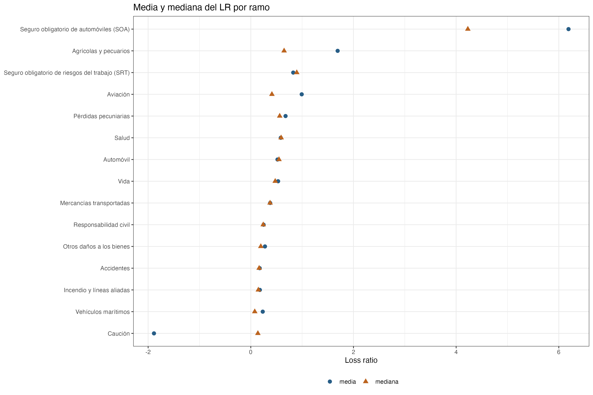
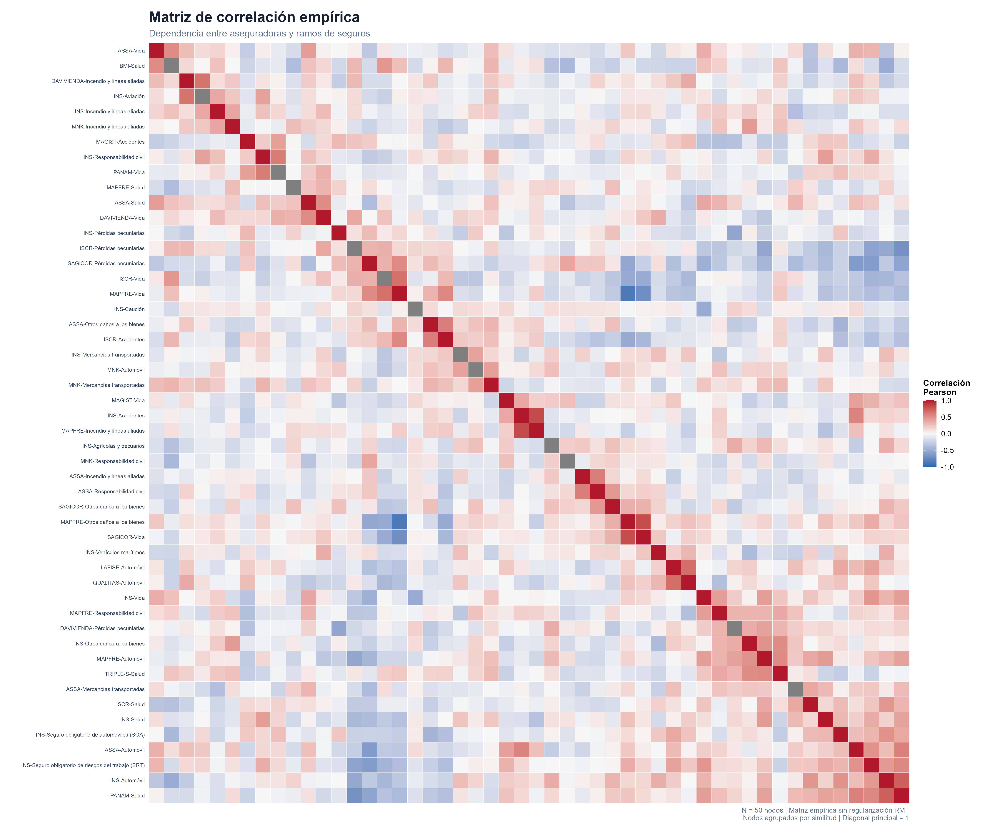
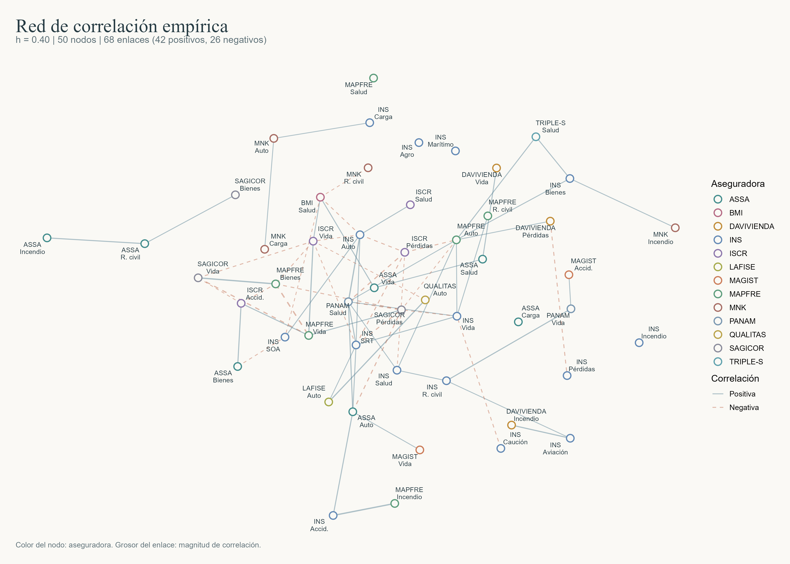
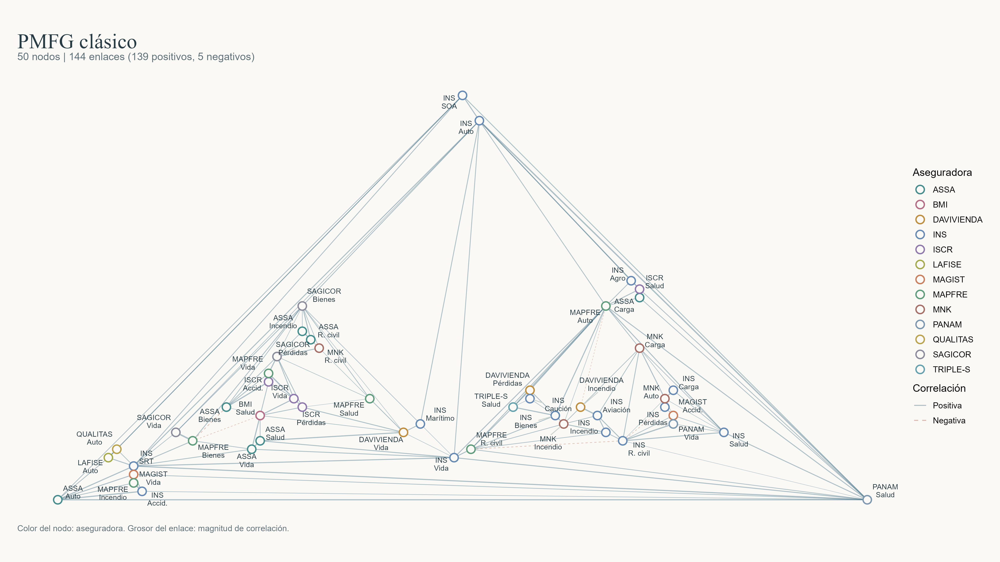
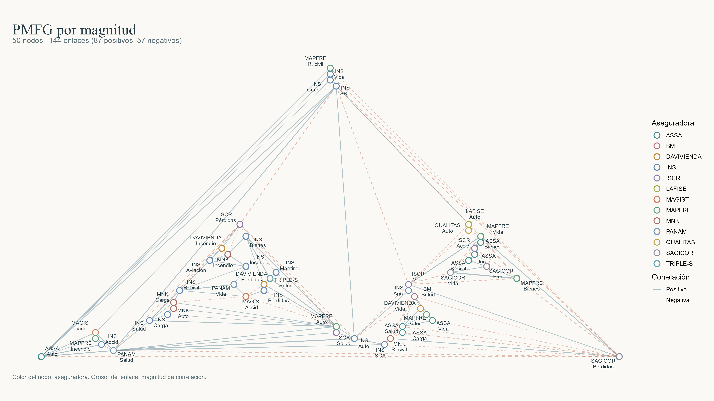
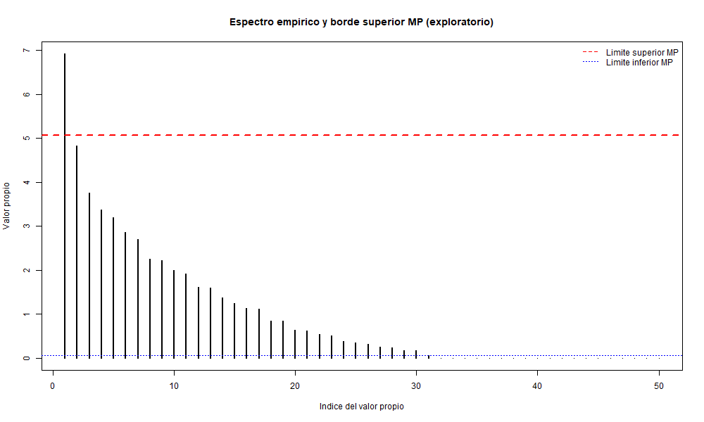

## 1. Motivación y planteamiento del proyecto

### 1.1. ¿Cómo se relacionan las líneas de seguro?

La tesis de Chen (2025) es la referencia principal que inspiró este proyecto. Su aplicación de la teoría de matrices aleatorias a las razones de siniestralidad y a las redes de riesgo en seguros nos llevó a explorar esas relaciones en el mercado costarricense con datos de SUGESE.

Estudiar cada serie de siniestralidad por separado permite conocer su nivel habitual, cuánto varía y en qué períodos aumentan los siniestros respecto de las primas. En este proyecto nos interesa también cómo se mueven unas series respecto de otras. Dos carteras con promedios distintos pueden subir al mismo tiempo, mientras que otras con niveles parecidos pueden moverse en sentidos opuestos.

Trabajamos con datos públicos de primas y siniestros de SUGESE. Cada combinación de aseguradora y ramo es un *nodo*, identificado por $i=(a,r)$. Así podemos comparar ramos de una misma empresa y aseguradoras que operan en un mismo ramo, sin resumir toda la actividad de cada compañía en una sola serie.

La pregunta es si hay grupos de nodos que tienden a moverse juntos y cuánto de esa relación puede deberse a tener pocas observaciones. El estudio de estas asociaciones sirve para analizar la diversificación, la concentración de exposiciones y las necesidades de reaseguro, y para describir qué partes del mercado se mueven de forma parecida.

### 1.2. El indicador y las correlaciones

Para cada nodo $i$ y período $t$, calculamos la razón entre siniestros brutos $S_{it}$ y primas brutas $P_{it}$:

$$
L_{it}=\frac{S_{it}}{P_{it}},\qquad P_{it}\ne0.
$$

Los montos originales son acumulados dentro del año, por lo que primero los convertimos en flujos trimestrales. Con ellos calculamos los siniestros por unidad de prima de cada nodo.

Organizamos los datos en una matriz $L\in\mathbb{R}^{N\times T}$, con un nodo por fila y un período por columna. Después centramos cada fila y la dividimos por su desviación estándar muestral. Esto permite comparar fluctuaciones entre series con distintos niveles y dispersiones.

La correlación de Pearson mide la asociación lineal entre dos series. En términos poblacionales,

$$
\rho_{ij}=\frac{\operatorname{Cov}(L_i,L_j)}
{\sqrt{\operatorname{Var}(L_i)\operatorname{Var}(L_j)}}.
$$

Una correlación positiva indica que ambas tienden a desviarse de su media en el mismo sentido; una negativa, en sentidos opuestos. La matriz reúne esas relaciones para todos los pares.

\newpage

### 1.3. De la matriz a los grafos y los grupos

Para leer la matriz como una red, usamos los pares aseguradora–ramo como nodos y sus correlaciones como enlaces. En este avance usamos una red *signed* por umbral para conservar las correlaciones positivas y negativas más fuertes. También construimos dos versiones del PMFG, que agregan conexiones mientras la red siga siendo planar.

Al variar el umbral podemos ver cómo se reduce la red y cuáles conexiones permanecen. Los PMFG ofrecen otra forma de resumir la matriz, con un número fijo de enlaces para el mismo conjunto de nodos.

Los grafos muestran las conexiones entre los nodos. Para buscar grupos comparamos las relaciones internas con las externas. MacMahon y Garlaschelli (2015) distinguen este problema del filtrado de enlaces y proponen una modularidad adaptada a matrices de correlación.

### 1.4. ¿Dónde entra la teoría de matrices aleatorias?

Con una muestra finita aparecen correlaciones distintas de cero incluso entre series independientes. El problema se hace más evidente cuando hay muchas series y pocos períodos. Con la teoría de matrices aleatorias (RMT) comparamos los valores propios de la matriz empírica con una referencia de ruido muestral.

Los valores propios indican cuánta variación corresponde a cada dirección de movimiento conjunto, descrita por su vector propio. El filtro conserva como señal los modos que superan el límite superior de esa referencia.

Las variantes de modularidad de MacMahon y Garlaschelli usan distintos modelos de referencia. $Q_2$ descuenta el ruido y $Q_3$ también retira el modo principal. Las cargas del vector propio muestran qué series participan en ese movimiento.

La parte numérica del proyecto consiste en construir la matriz, calcular sus valores y vectores propios, reconstruir las componentes filtradas y estudiar las particiones que se obtienen. En este avance presentamos los primeros resultados sobre el panel actual.

\newpage

## 2. Hallazgos del proyecto

### 2.1. Análisis exploratorio

El panel contiene 50 series y 32 trimestres, de 2015 a 2022, para un total de 1600 observaciones. Los gráficos de cambios trimestrales y anuales muestran oscilaciones recurrentes en Automóvil y en el seguro obligatorio de riesgos del trabajo (SRT), además de movimientos abruptos en Caución y en el seguro obligatorio de automóviles (SOA).

La media de las razones individuales es 0,6408 y la mediana es 0,3269. Para comparar ramos, sumamos los siniestros y las primas entre aseguradoras en cada trimestre, calculamos su cociente y luego resumimos los valores a lo largo del tiempo.

SOA destaca con una media de 6,1891 y una mediana de 4,2280. La media supera bastante a la mediana, por lo que las observaciones altas tienen un peso importante en el promedio. También aparecen valores negativos en el panel.

{#fig-eda width=14cm fig-pos="H"}

\newpage

### 2.2. Matriz de correlación empírica

Construimos $L\in\mathbb{R}^{50\times32}$ y estandarizamos cada fila con su media $\bar L_i$ y su desviación estándar muestral $s_i$. Con $T=32$,

$$
X_{it}=\frac{L_{it}-\bar L_i}{s_i},
\qquad
C=\frac{XX^{\mathsf T}}{T-1},
\qquad
C_{ij}=\frac{1}{T-1}\sum_{t=1}^{T}X_{it}X_{jt}.
$$

La matriz resultante es simétrica y tiene unos en la diagonal. En la figura ordenamos los nodos por similitud para facilitar la lectura.

{#fig-correlacion width=16.5cm fig-pos="H"}

Entre los 1225 pares distintos, la correlación media es 0,0114 y la mediana es 0,0009. Aun así, hay relaciones fuertes de ambos signos. Por ejemplo, INS–Accidentes y MAPFRE–Incendio y líneas aliadas tienen una correlación de $0{,}8237$, mientras que MAPFRE–Otros daños a los bienes y MAPFRE–Vida tienen una de $-0{,}8665$. El promedio cercano a cero resume relaciones positivas y negativas que se compensan entre sí.

\newpage

### 2.3. Red signed por umbral

En esta red conservamos un enlace entre nodos distintos cuando $|C_{ij}|\geq h$. El peso sigue siendo $C_{ij}$, con su signo original. Así mantenemos en una misma figura las series que se mueven juntas y las que se mueven en sentidos opuestos. Usamos tres umbrales para comparar cuántas conexiones quedan:

| Umbral $h$ | Enlaces | Positivos | Negativos |
|:----------:|--------:|----------:|----------:|
| 0,30 | 161 | 94 | 67 |
| 0,40 | 68 | 42 | 26 |
| 0,50 | 32 | 18 | 14 |

Al pasar de 0,30 a 0,50, la red pierde 129 enlaces. En los tres casos mantenemos los 50 nodos, incluidos los que quedan aislados, y usamos las mismas posiciones para poder comparar las figuras.

{#fig-umbral width=16cm fig-pos="H"}

La figura intermedia conserva 68 conexiones, de las cuales 26 son negativas. Conservar ambos signos permite ver esas relaciones en una misma red. Las tres redes se generan con `R/visualizar_redes.R` a partir de la matriz empírica.

\newpage

### 2.4. PMFG por correlación y por magnitud

El *Planar Maximally Filtered Graph* (PMFG) de Tumminello et al. (2005) prueba los pares en orden y acepta un enlace si la red sigue siendo planar. Comparamos el orden clásico, por $C_{ij}$ descendente, con una adaptación por $|C_{ij}|$ descendente. Ambos conservan el signo original y alcanzan $3N-6=144$ enlaces.

| Criterio de orden | Positivos | Negativos | Total |
|:------------------|----------:|----------:|------:|
| Correlación $C_{ij}$ | 139 | 5 | 144 |
| Magnitud $\lvert C_{ij}\rvert$ | 87 | 57 | 144 |

{#fig-pmfg-clasico width=14cm fig-pos="H"}

{#fig-pmfg-magnitud width=14cm fig-pos="H"}

Los PMFG comparten 75 enlaces. El de magnitud conserva la correlación de $-0{,}8665$ entre MAPFRE–Otros daños a los bienes y MAPFRE–Vida. La forma triangular viene del acomodo planar sin cruces. Ambos PMFG se construyeron a partir de la matriz empírica.

\newpage

### 2.5. Marchenko–Pastur y elección de modularidad

Con $N=50$ y $T=32$, los límites de Marchenko–Pastur (MP) son

$$
q=\frac NT=1{,}5625,\qquad
\lambda_{\pm}=(1\pm\sqrt q)^2,
\qquad
[\lambda_-,\lambda_+]=[0{,}0625;\,5{,}0625].
$$

El primer valor propio es $\lambda_1=6{,}9270$ y el segundo es $\lambda_2=4{,}8250$. Solo el primero supera el límite superior y concentra el 13,85 % de la variación total. También hay un valor positivo por debajo del límite inferior ($0{,}0553$) y 19 valores prácticamente nulos. Estos últimos se explican por el rango máximo $T-1=31$ de la matriz centrada; para $q>1$, MP también incluye una masa en cero.

{#fig-mp width=12.8cm fig-pos="H"}

El filtro reúne los modos con $\lambda_a\leq\lambda_+$ en $C^{(r)}$ y conserva $C^{(s)}=C-C^{(r)}$. La modularidad $Q_2$ de MacMahon y Garlaschelli (2015, ec. 34) usa esa señal:

$$
Q_2(g)=\frac{\sum_{i,j}C^{(s)}_{ij}\,\mathbf{1}\{g_i=g_j\}}
{\sum_{i,j}C_{ij}},
\qquad C^{(s)}=\lambda_1v_1v_1^{\mathsf T}.
$$

Como solo conservamos un modo, retirarlo también, como hace $Q_3$, deja una matriz nula salvo redondeo y todas las particiones reciben el mismo valor. Por eso usamos $Q_2$ para distinguir las particiones. $Q_1$ se mantiene como referencia, aunque no descuenta el ruido. Con $Q_2$ obtenemos grupos de 33 y 17 nodos, separados por los signos del primer vector propio.

Seguiremos con el análisis de la composición de los grupos y la comparación de sus conexiones en las redes.

\newpage

## Referencias

Chen, C.-P. (2025). *The Three Studies on Applying Random Matrix Theory to Loss Ratios for General Insurance Companies*. Tesis doctoral, Departamento de Gestión de Riesgos y Seguros, National Chengchi University.

MacMahon, M. y Garlaschelli, D. (2015). *Community Detection for Correlation Matrices*. *Physical Review X*, **5**, 021006. [doi:10.1103/PhysRevX.5.021006](https://doi.org/10.1103/PhysRevX.5.021006).

Tumminello, M., Aste, T., Di Matteo, T. y Mantegna, R. N. (2005). *A tool for filtering information in complex systems*. *Proceedings of the National Academy of Sciences*, **102**(30), 10421–10426. [doi:10.1073/pnas.0500298102](https://doi.org/10.1073/pnas.0500298102).

## Repositorio del proyecto

Los datos, scripts de R y figuras del avance están en:

\url{https://github.com/sebas-miranda/riesgo_mercado_asegurador_MA0501}
